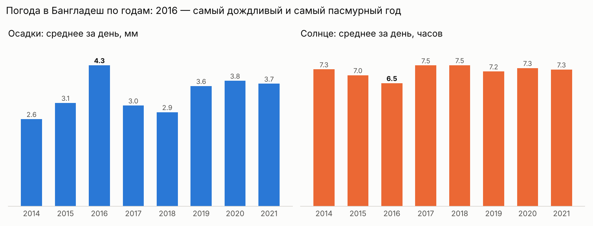
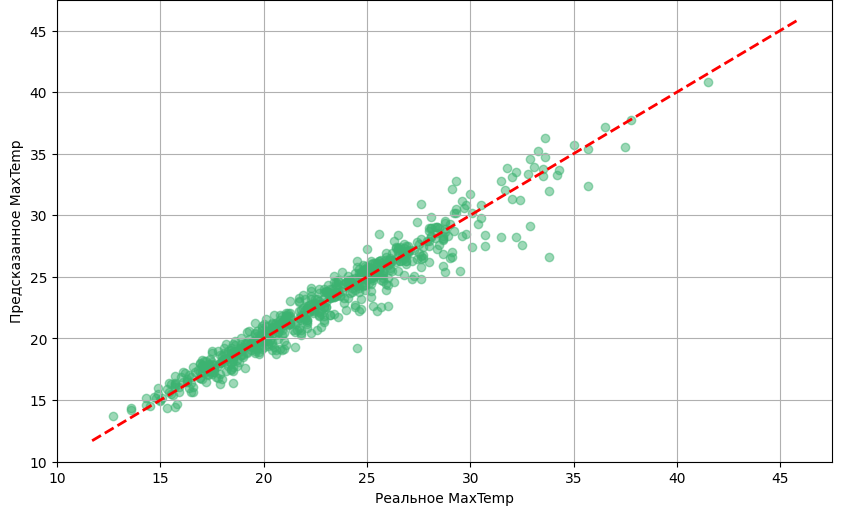

# Анализ и прогноз погоды в Бангладеш

Два учебных проекта на одних данных: около 10 лет ежедневных наблюдений за погодой в Бангладеш (температура, осадки, солнце, ветер, влажность). Выполнены в Google Colab.

## 1. Анализ погоды — `weather_analysis.ipynb`

Вопрос: изменилась ли погода между первой и второй половиной периода наблюдений?

- Данные разделены по медианной дате (25.07.2017) на два периода.
- Распределения температур сравнены через **косинусное сходство**: минимальная температура — 0.93, максимальная — 0.97. Значит, температурный режим в двух периодах очень похож.
- Осадки почти не изменились: в среднем 3.3–3.4 мм в день, дождливых дней 409 и 434.
- По годам самым дождливым и одновременно самым пасмурным был **2016**: 4.3 мм осадков и 6.5 часа солнца в день.

## 2. Прогноз максимальной температуры — `maxtemp_prediction.ipynb`

Модель Gradient Boosting предсказывает максимальную температуру дня по остальным показателям погоды.

**Результат: R² = 0.944** — модель объясняет 94% изменений температуры. Точки на графике лежат близко к красной линии идеального прогноза.

## Технологии

Python · pandas · NumPy · scikit-learn · Matplotlib · Seaborn · Google Colab
